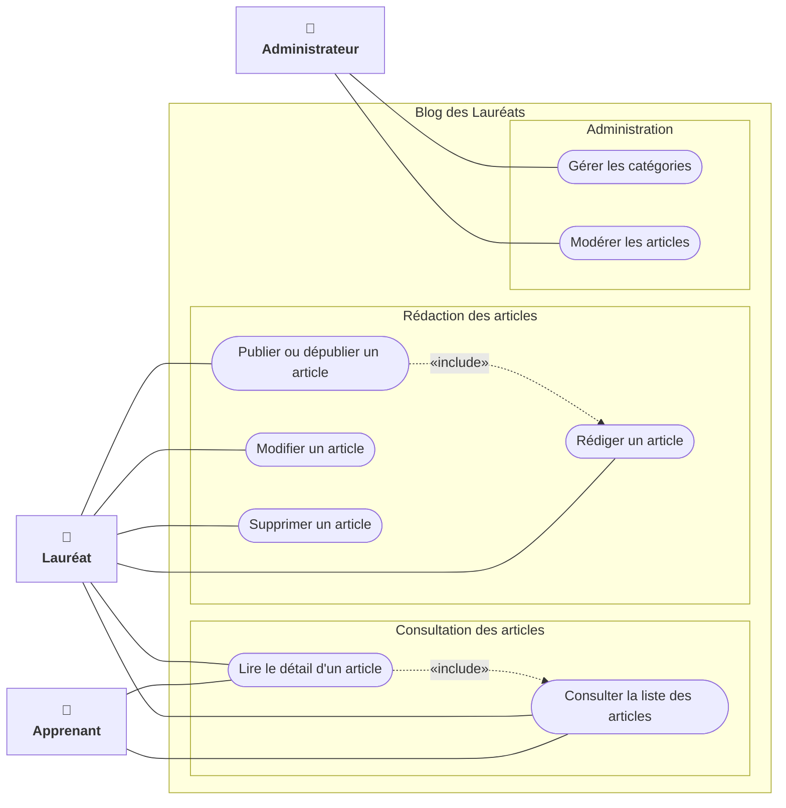

# Diagramme de cas d’utilisation

Le diagramme de cas d’utilisation présente les acteurs du Blog des Lauréats et les actions qu’ils peuvent réaliser.

## Acteurs

- **Apprenant** : consulte et lit les articles publiés par les lauréats.
- **Lauréat** : rédige, publie et administre ses propres articles.
- **Administrateur** : gère les catégories et modère l’ensemble des articles.

## Diagramme

_Figure : Cas d’utilisation du Blog des Lauréats._

## Lecture du diagramme

- La consultation est ouverte aux apprenants et aux lauréats : la liste des articles mène au détail de chaque article.
- La rédaction est réservée aux lauréats, qui ne gèrent que leurs propres articles.
- L’administrateur intervient sur les catégories et sur la modération de l’ensemble du contenu.

Le premier sprint couvre la consultation du détail d’un article tel que décrit dans `sprints/sprints.md`.