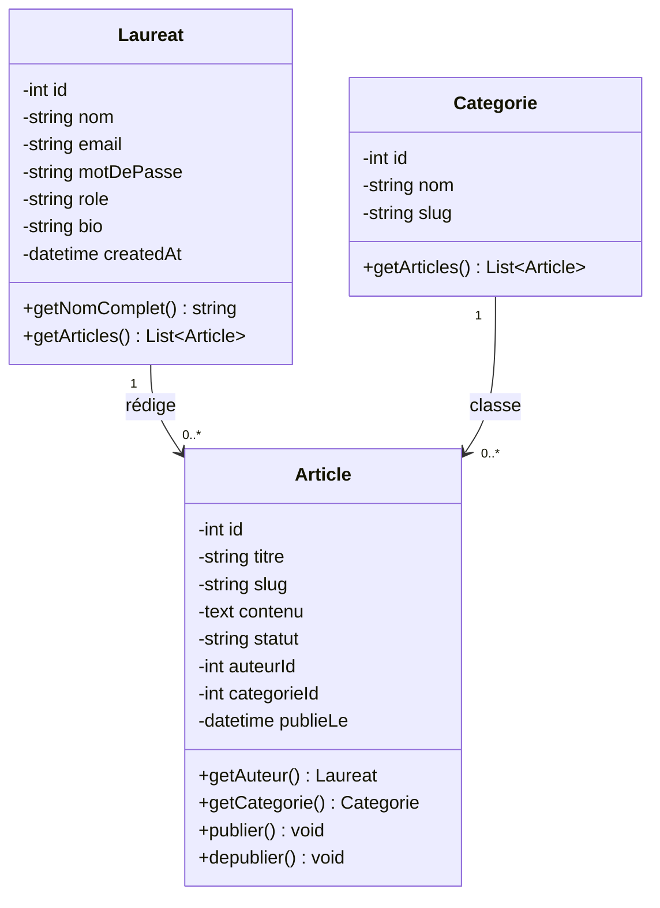

# Diagramme de classes

Le diagramme de classes décrit les entités principales du Blog des Lauréats : le lauréat qui rédige les articles, l’article publié et la catégorie qui le classe.

## Description des classes

- **Lauréat** : compte de l’auteur, identifié par son nom, son adresse électronique et son rôle. Un lauréat peut rédiger plusieurs articles.
- **Article** : contenu rédigé par un lauréat. Il possède un titre, un identifiant lisible (`slug`), un contenu, un statut (brouillon ou publié), une date de publication, ainsi qu’un auteur et une catégorie.
- **Catégorie** : classement thématique des articles (par exemple : développement web, mobile, insertion professionnelle).

## Relations

- Un **lauréat** rédige de zéro à plusieurs **articles** ; chaque article possède exactement un auteur.
- Une **catégorie** classe de zéro à plusieurs **articles** ; chaque article appartient à une catégorie.

Ces classes correspondent aux modèles Eloquent manipulés par les classes Service de l’application, la consultation d’un article publié étant la fonctionnalité livrée lors du premier sprint.