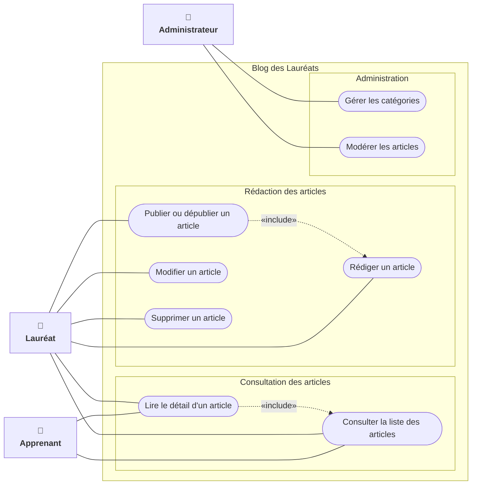
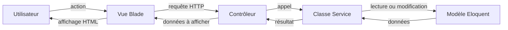
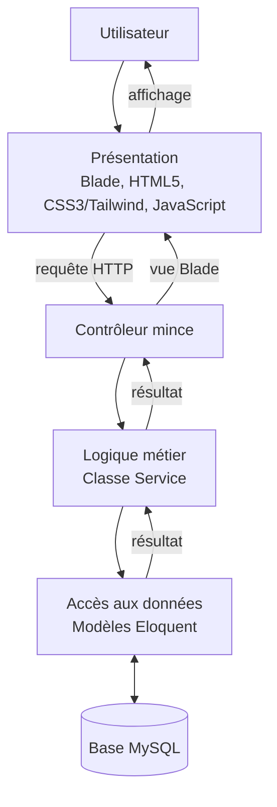
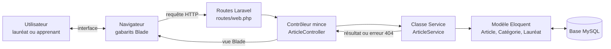
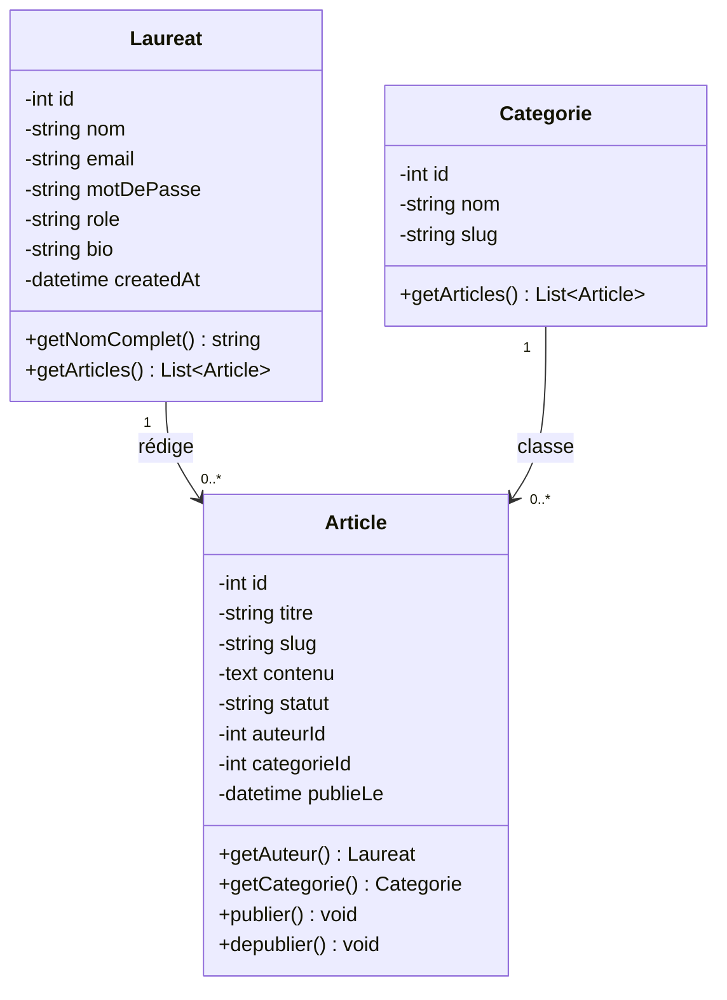

# Rapport de Projet

> Document consolidé généré automatiquement.

> Date de génération : 2026-11-19

---

# Remerciement

---

# Table des matières

- Remerciement
- Introduction
- Contexte du projet
- Cahier des charges
- Méthodologie de travail
- Méthode SCRUM
- Processus 2TUP
- Design thinking
- Planification
- Branche fonctionnelle
- Carte d'empathie
- Définition du problème
- Idéation
- Diagramme de cas d’utilisation
- Branche technique
- Stack technologique
- Architecture du système
- Prototype (fonctionnalités, classes)
- Conception
- Diagramme de classes
- Maquettes
- Réalisation
- Interfaces
- Conclusion

---

# Introduction

---

# Contexte du projet

---

# Cahier des charges

---

# Méthodologie de travail

---

# Méthode SCRUM

## La méthode SCRUM

La méthodologie Scrum est une méthodologie agile qui permet de gérer un projet de manière flexible et collaborative, en favorisant la livraison progressive de fonctionnalités. Elle repose sur l’itération, la priorisation des tâches et la communication régulière entre les membres de l’équipe. Dans le cadre du projet Blog des Lauréats, nous avons organisé le travail selon les principes de Scrum, ce qui nous a permis de mieux planifier, suivre et livrer les différentes fonctionnalités de manière efficace.

*Figure : La méthode SCRUM*

**Principe Scrum :**

- **Transparence** : visibilité complète sur les tâches, les objectifs et l’avancement du projet pour toute l’équipe.
- **Inspection** : évaluation régulière à la fin de chaque sprint afin d’identifier les erreurs, les blocages et les axes d’amélioration.
- **Adaptation** : ajustement du plan de travail en fonction des retours et des résultats obtenus lors des sprints.

**Organisation du projet en sprints :**

### Sprint 1 : Initialisation, cadrage et première fonctionnalité Laravel

- **Statut** : actif.
- **Objectif** : initialiser le dépôt distant avec GitHub CLI, outiller l’environnement avec un Agent IA et un catalogue de missions, cadrer le projet sous gouvernance Scrum, modéliser le contexte et les cas d’utilisation avec Mermaid, structurer le Product Backlog dans `issues/`, puis développer sous Laravel la page de consultation détaillée d’un article.
- **Travaux réalisés** : mise en place du dépôt et des dossiers du projet, formalisation du flux de travail, planification du sprint, modélisation fonctionnelle et première implémentation de la consultation d’un article avec un gabarit Blade responsive et la gestion de l’erreur 404.

Les sprints suivants seront ajoutés au fil des sessions de planification, conformément au suivi tenu dans le dossier `sprints/`.

---

# Processus 2TUP

## Définition

La méthode **2TUP** (*Two Tracks Unified Process*) est une méthode de développement logiciel agile et itérative. Elle peut être adaptée au contexte du **Blog des Lauréats**, à ses objectifs et aux besoins des **lauréats et des apprenants de Solicode Tanger**.

Sa particularité repose sur une architecture en « Y » qui sépare distinctement deux axes de réflexion :

- **la branche fonctionnelle**, consacrée à la compréhension des utilisateurs, des processus et des besoins métier ;
- **la branche technique**, consacrée à l’étude des contraintes techniques, à la conception de l’architecture et au choix des technologies.

La branche fonctionnelle permet de définir la **rédaction, la publication et la consultation d’articles professionnels**, tandis que la branche technique permet de déterminer l’architecture et les outils nécessaires, tels que **Laravel, Blade, Tailwind et MySQL**.

Ces deux branches progressent en parallèle, puis se rejoignent dans une phase de réalisation. Cette organisation permet de limiter les risques, de vérifier la cohérence entre les besoins métier et la solution technique, et de faire évoluer progressivement le produit.

## Schéma

Le schéma suivant présente le fonctionnement général de la méthode 2TUP.

**Figure : Processus 2TUP appliqué au Blog des Lauréats**

La branche fonctionnelle part de la capture des besoins et aboutit à l’analyse fonctionnelle. En parallèle, la branche technique part des besoins techniques et aboutit à la définition de l’architecture et des technologies. La convergence des deux branches déclenche la phase de réalisation, qui comprend la conception, le codage, les tests, la recette et le déploiement.

## Conclusion

La méthode 2TUP fournit un cadre de travail structuré et adaptable pour la réalisation du **Blog des Lauréats**. La séparation entre les branches fonctionnelle et technique facilite la compréhension des besoins et permet de prendre les décisions techniques au moment approprié.

En réunissant ces deux branches dans une phase de réalisation progressive, la méthode favorise la maîtrise des risques, l’amélioration continue et l’alignement du produit final sur les besoins des **lauréats et des apprenants de Solicode Tanger**. Elle constitue ainsi une approche pertinente pour les projets dont les exigences fonctionnelles et les contraintes techniques doivent être analysées conjointement.

---

# Design thinking

L’adoption de la méthode Scrum a permis d’assurer une organisation efficace du travail et une meilleure gestion du projet. Elle a contribué à améliorer la qualité des fonctionnalités développées et à garantir un déroulement structuré du projet Blog des Lauréats.

## Design thinking

Le Design Thinking est une approche de résolution de problèmes centrée sur l’humain. Elle vise à comprendre en profondeur les besoins réels des utilisateurs afin de concevoir des solutions innovantes, utiles et adaptées. Cette méthode est largement utilisée dans les domaines du design, de la technologie, de l’éducation et de l’innovation pour répondre à des problématiques complexes.

*Figure : Méthodologie Design Thinking*

Le Design Thinking est particulièrement utilisé pour :

- Encourager la créativité et l’innovation dans la conception de solutions ;
- Proposer des réponses réellement adaptées aux besoins des utilisateurs ;
- Favoriser la collaboration entre différentes équipes de travail ;
- Résoudre des problèmes complexes ou mal définis de manière structurée.

## Les étapes du Design Thinking

Le processus du Design Thinking se compose de plusieurs étapes essentielles :

- **Empathie (Empathize)** : cette étape consiste à comprendre l’utilisateur en l’observant, en l’interrogeant et en analysant son comportement. L’objectif est d’identifier ses besoins, ses attentes et ses difficultés réelles.
- **Définition du problème (Define)** : elle permet de regrouper les informations collectées afin de formuler un problème clair et centré sur l’utilisateur, souvent exprimé sous forme de question comme : « Comment pourrions-nous améliorer… ? »
- **Idéation (Ideate)** : cette phase consiste à générer un maximum d’idées possibles sans jugement, en utilisant des techniques comme le brainstorming ou le mind mapping afin de stimuler la créativité.
- **Prototype** : elle consiste à créer une version simplifiée de la solution proposée (maquette, interface ou modèle) afin de tester rapidement les idées.
- **Test** : cette dernière étape permet de tester le prototype auprès des utilisateurs, de recueillir leurs retours et d’améliorer la solution en fonction des résultats obtenus.

Le Design Thinking est donc une méthode structurée et flexible qui permet de transformer une idée en solution concrète en mettant toujours l’utilisateur au centre du processus. Appliqué au Blog des Lauréats, il aide à concevoir une consultation d’articles simple et lisible pour les apprenants de Solicode Tanger, et une rédaction confortable pour les lauréats.

---

# Planification

---

# Branche fonctionnelle

---

# Carte d'empathie

---

# Définition du problème

---

# Idéation

---

# Diagramme de cas d’utilisation

Le diagramme de cas d’utilisation présente les acteurs du Blog des Lauréats et les actions qu’ils peuvent réaliser.

## Acteurs

- **Apprenant** : consulte et lit les articles publiés par les lauréats.
- **Lauréat** : rédige, publie et administre ses propres articles.
- **Administrateur** : gère les catégories et modère l’ensemble des articles.

## Diagramme

_Figure : Cas d’utilisation du Blog des Lauréats._

## Lecture du diagramme

- La consultation est ouverte aux apprenants et aux lauréats : la liste des articles mène au détail de chaque article.
- La rédaction est réservée aux lauréats, qui ne gèrent que leurs propres articles.
- L’administrateur intervient sur les catégories et sur la modération de l’ensemble du contenu.

Le premier sprint couvre la consultation du détail d’un article tel que décrit dans `sprints/sprints.md`.

---

# Branche technique

Dans cette section, nous présentons la branche technique du projet Blog des Lauréats, qui consiste à décrire les choix technologiques, les outils et l’architecture adoptés pour assurer le bon fonctionnement de l’application, tout en garantissant une solution performante, sécurisée et adaptée aux besoins identifiés.

---

## Choix technologiques

Dans le cadre de ce projet, plusieurs technologies modernes et complémentaires ont été sélectionnées pour garantir la performance, la maintenabilité et la rapidité de la plateforme de publication des lauréats de Solicode Tanger.

### Technologies backend

- **PHP et Laravel 13** : framework backend en architecture MVC, fournissant les routes, la validation, la gestion des erreurs (dont la page 404) et le rendu des gabarits Blade.
- **Architecture 3-tiers / MVC** : séparation entre la présentation, la logique métier et l’accès aux données, avec un **contrôleur mince** qui délègue le traitement à une **classe Service**.

### Technologies frontend

- **Gabarits Blade** : moteur de rendu natif de Laravel, utilisé pour structurer l’interface en composants réutilisables et responsives.
- **HTML5 et CSS3/Tailwind** : mise en page moderne, responsive et adaptée aux différents écrans.
- **JavaScript** : interactions légères côté navigateur (navigation, menus, confirmations).

### Base de données

- **MySQL** : système de gestion de base de données relationnelle fiable, utilisé pour stocker les articles, les catégories et les comptes des lauréats.

### Outils et utilitaires externes

- **Mermaid** : génération des diagrammes de contexte, de cas d’utilisation et de classes à partir d’une syntaxe textuelle.
- **Git et GitHub CLI (`gh`)** : gestion des versions, branches dédiées par sprint et publication du dépôt.
- **Agent IA (Antigravity / Copilot)** : skills natifs et règles Always-On pour assister la rédaction et le développement.
- **Markdown et Marp** : rédaction de la documentation et des diaporamas de restitution.
- **Node.js** : compilation automatique du rapport modulaire (`concat-chapitres.js`).

---

# Stack technologique

---

# Architecture du système

## Architecture MVC

Le modèle MVC répartit l'application en trois rôles :

- **Modèle** : représente les données et les règles qui leur sont liées (articles, catégories, comptes des lauréats).
- **Vue** : affiche les informations et reçoit les actions de l'utilisateur, au moyen des gabarits Blade.
- **Contrôleur** : reçoit une action, sollicite la logique métier et transmet le résultat à la vue.

_Figure 1 — Échange MVC : le contrôleur coordonne la vue, le service et le modèle lors d’une requête._

Dans le projet, MVC est fourni par Laravel : les routes associent une URL à un contrôleur. Le contrôleur reste **mince** : il valide l’entrée, appelle une classe Service qui porte le traitement métier, puis retourne une vue Blade ou une réponse d’erreur. Les modèles Eloquent représentent les tables MySQL et les vues Blade produisent le HTML envoyé au navigateur.

## Architecture 3-tiers

Cette architecture sépare l’application en couches qui communiquent de proche en proche :

- **Présentation** : gabarits Blade responsives (HTML5, CSS3/Tailwind, JavaScript) ; envoie les requêtes et affiche les réponses.
- **Logique métier** : contrôleurs minces et classes Service qui appliquent les règles du projet.
- **Accès aux données** : modèles Eloquent qui lisent et écrivent dans la base MySQL.

_Figure 2 — Les trois tiers séparent l’interface, le traitement des opérations et le stockage._

## Architecture globale

Le Blog des Lauréats permet à un lauréat de Solicode Tanger de rédiger, publier et administrer ses articles, et aux apprenants de consulter ces retours d’expérience. L’application est déployée en ligne et repose sur Laravel, Blade et MySQL.

_Figure 3 — Architecture globale du Blog des Lauréats._

Le parcours d’une requête est le suivant :

1. Le navigateur demande l’URL d’un article (`/articles/{slug}`).
2. La route Laravel transmet la requête à `ArticleController`, qui reste mince et délègue le travail à `ArticleService`.
3. Le service lit l’article via le modèle Eloquent, puis déclenche une erreur 404 si l’article n’existe pas ou n’est pas publié.
4. Le contrôleur transmet les données à la vue Blade, qui renvoie la page HTML consultable.

---

# Prototype (fonctionnalités, classes)

---

# Conception

---

# Diagramme de classes

Le diagramme de classes décrit les entités principales du Blog des Lauréats : le lauréat qui rédige les articles, l’article publié et la catégorie qui le classe.

## Description des classes

- **Lauréat** : compte de l’auteur, identifié par son nom, son adresse électronique et son rôle. Un lauréat peut rédiger plusieurs articles.
- **Article** : contenu rédigé par un lauréat. Il possède un titre, un identifiant lisible (`slug`), un contenu, un statut (brouillon ou publié), une date de publication, ainsi qu’un auteur et une catégorie.
- **Catégorie** : classement thématique des articles (par exemple : développement web, mobile, insertion professionnelle).

## Relations

- Un **lauréat** rédige de zéro à plusieurs **articles** ; chaque article possède exactement un auteur.
- Une **catégorie** classe de zéro à plusieurs **articles** ; chaque article appartient à une catégorie.

Ces classes correspondent aux modèles Eloquent manipulés par les classes Service de l’application, la consultation d’un article publié étant la fonctionnalité livrée lors du premier sprint.

---

# Maquettes

---

# Réalisation

---

# Interfaces

---

# Conclusion

---
